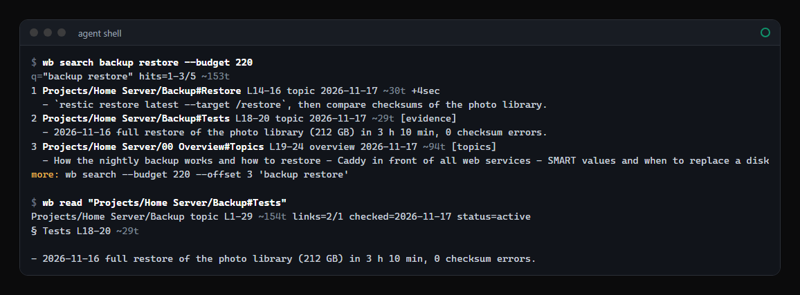
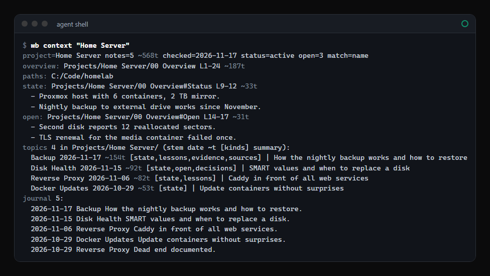
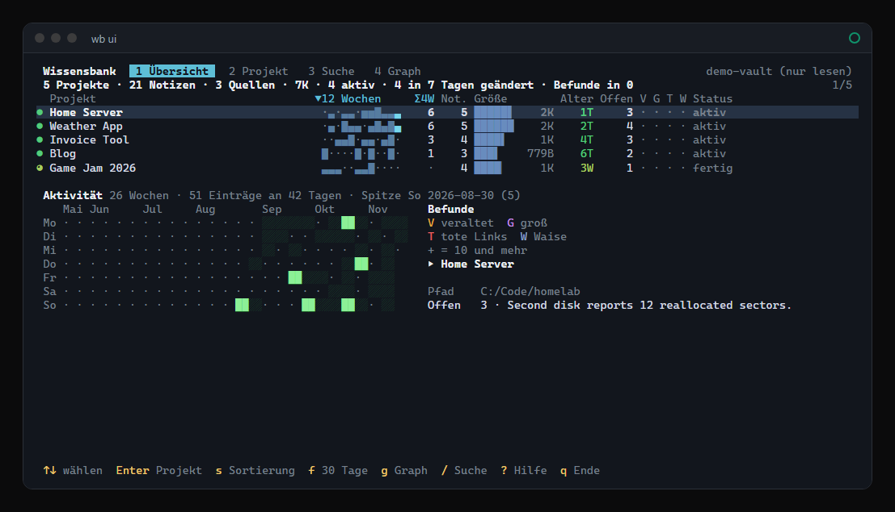
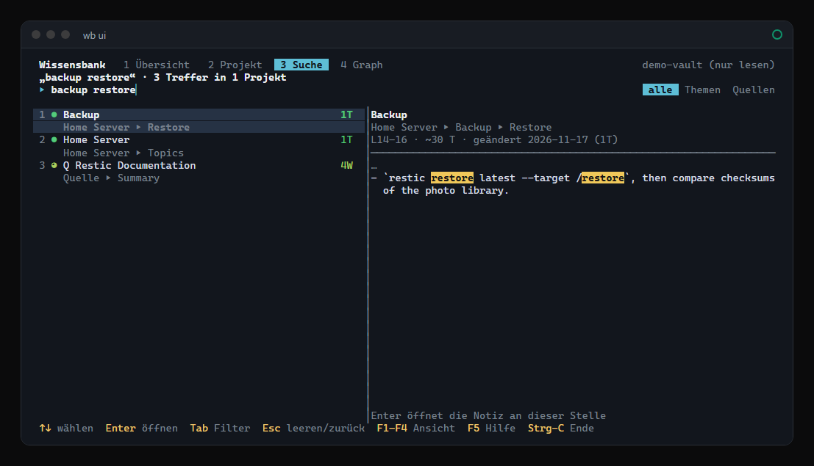
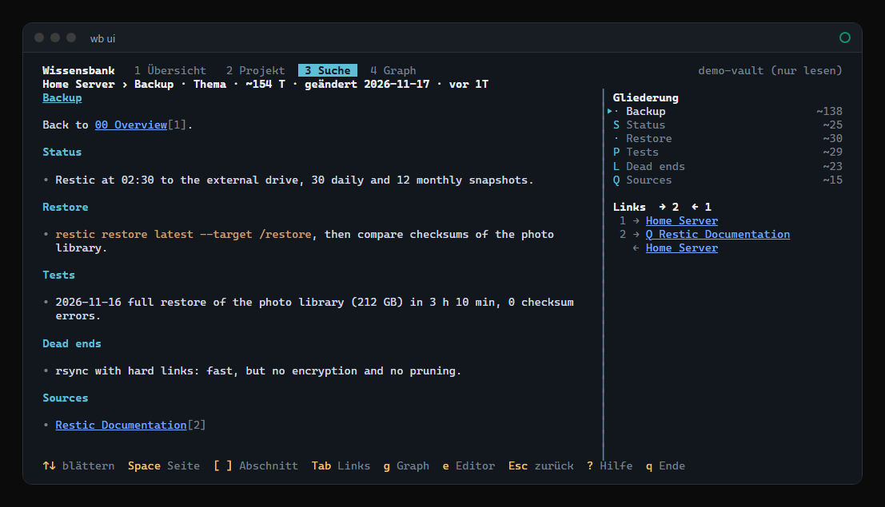

<p align="center"></p>

# wb

**Memory for coding agents, kept in plain Markdown.**

Your agent solves a problem today and has forgotten it tomorrow. `wb` gives it a knowledge base
it can search before every task and write to after: notes in a folder you own, and a small
command line tool that finds the one section that answers the question.

It runs locally, in one binary, with no server and no account. Works with Claude Code, Codex and
any agent that can run a shell command.

<p align="center"></p>

Every hit is a section, not a file. It comes with an address the agent can read next and a price
in tokens, so the agent knows what a lookup costs before it pays for it.

> [!NOTE]
> The commands, flags and JSON output are language-neutral. The help texts and messages of the
> tool are currently in German. An English interface is a welcome contribution.

## Finds more, costs less

Agents usually look things up with glob, grep and "read the whole file". We measured that against
`wb` on a real vault of over 1,000 notes, with 28 questions an agent would ask before a task. These
questions were held back during development and run separately.

| Method | Answer in the top 3 | Right at the top | Tokens until the answer |
|---|---:|---:|---:|
| **`wb search` + `wb read`** | **28 of 28** | **24** | **1,016** |
| `ripgrep`, files ranked by matched terms | 26 of 28 | 17 | 1,896 |
| Glob, grep, read whole files | 7 of 28 | 7 | 2,737 |

Speed is on par with `ripgrep`: 20 to 40 ms per call, including the start of the process.
`ripgrep` is just as good when you already know the project name or a rare identifier.
The gain is in everything else, and in the tokens: about 45 % fewer until the answer.

## Get started

You need [Rust](https://rustup.rs) 1.91 or newer.

```bash
git clone https://github.com/Nfinds/wissensdatenbank
cd wissensdatenbank
cargo install --path crates/wb-cli
```

Create a vault from the empty template and build its index:

```bash
cp -a examples/vault ~/notes
cd ~/notes
wb sync --init
```

Then try it:

```bash
wb context                             # list your projects
wb context Example                     # status, open points, topics, latest journal lines
wb search backup restore               # hits by section, with token prices
wb read "Projects/Example/Backup#Restore"
```

`wb` finds your vault through `--vault`, the environment variable `WB_VAULT`, a
[config file](examples/config.toml), or the nearest folder with a `.wb/` index above the current
directory.

## One call briefs your agent

<p align="center"></p>

`wb context` is where an agent starts. One call returns the status of the project, what is still
open, every topic with a one-line summary, and the last changes. From there it reads only what it
needs.

To teach your agent the routine, paste [`examples/AGENT-RULES.md`](examples/AGENT-RULES.md) into
its instruction file (`CLAUDE.md`, `AGENTS.md`). The output format, budgets and exit codes are in
[`docs/AGENT-GUIDE.md`](docs/AGENT-GUIDE.md).

## Commands

| Command | What it does |
|---|---|
| `wb context` | Entry point: one project at a glance, or the list of all projects |
| `wb search` | Search by section, in German and English, tolerant of typos, umlauts and compounds |
| `wb read` | Read one note, one section or a line range, never more than the budget |
| `wb new` | Create a note with valid frontmatter and link it in the project overview. Never overwrites |
| `wb log` | Append one line to the journal, safe with several agents at once |
| `wb mv` | Rename or move a note and rewrite every link that points to it |
| `wb check` | Find dead links, broken frontmatter, orphaned or oversized notes and suspected secrets |
| `wb sync` | Bring the index up to date. Runs by itself before every read |
| `wb ui`, `wb stats` | The terminal views for people |

Every read command takes `--budget <tokens>` as a hard limit. Whatever is cut off is named by a
`more:` line with the exact command that continues. `--json` gives the same fields for parsers.

## A terminal UI for you

`wb ui` shows where your knowledge lives, what is active and what is going stale. Keyboard only.

<p align="center"></p>

<p align="center">
  
  
</p>

Above the overview of all projects, below the search with live preview and the reader. A fourth
view maps one project and the links between its notes. The screenshots show
[`docs/demo-vault`](docs/demo-vault), a vault with invented projects.

## Your notes stay plain files

A vault is a folder of Markdown. Edit it with any editor, sync it with any tool, put it in Git.
The index in `.wb/` is derived: delete it and `wb sync --full` builds it again.

```
Projects/<Project>/00 Overview.md   the map: status, open points, list of topics
Projects/<Project>/<Topic>.md       one note per subsystem, decision or investigation
Sources/Web/<Source>.md             web sources
Journal/YYYY-MM.md                  one line per change
```

Each note starts with three lines of frontmatter:

```yaml
---
type: topic            # overview | topic | source
status: active         # active | paused | done | superseded
checked_on: 2026-01-31
---
```

`wb` reads the headings to know what a section is about. `Status`, `Open`, `Decisions`,
`Dead ends`, `Tests` and `Sources` are recognised, in English and in German.

## Under the hood

<details>
<summary><b>Design decisions</b></summary>

- **Files are the truth, the index is derived.** Nothing lives only in the database.
- **SQLite FTS5**, bundled, with WAL: one store for full text, trigrams, links and the journal.
  Several processes can read and write at once.
- **Stemming and folding happen in Rust before FTS5** (Snowball for German and English, lower
  case, no diacritics, `ß` to `ss`), so `Größe`, `groesse` and `Grosse` match each other.
- **A passage is a section**, from one heading to the next. Snippets are cut at sentence ends.
- **The same state gives byte-identical output.** Timings appear only with `--timing`, on stderr.
- **Writes never leave half a state.** `wb new` creates exclusively, `wb log` appends under a
  lock, and `wb mv` finishes an interrupted run on the next start.

Rejected along the way: tantivy (heavy, one writer, would need a second store for links), an
index held in memory (no transactions), a custom FTS5 tokenizer (unsafe FFI), and lines as
passages (too short, too many hits per note).

</details>

<details>
<summary><b>Limits</b></summary>

- `wb` matches words, not meaning. A question that shares no word, stem or part of a word with a
  note will not find it.
- A change that keeps the file size and resets the modification time goes unnoticed until
  `wb sync --full`.
- Copy a vault with its timestamps (`cp -a`, `robocopy /COPY:DAT`). Otherwise notes without
  `checked_on` look as if they changed today.
- Code is recognised in fenced blocks and backticks only. Indented code counts as text.
- `wb new` writes German section headings (`Stand`, `Offen`). Rename them freely.
- Developed and tested on Windows. On Linux and macOS the local time is currently taken as UTC,
  so journal dates can be a day off around midnight, and paths are compared without regard to
  case.

</details>

<details>
<summary><b>What is in this repository</b></summary>

| Path | Content |
|---|---|
| `crates/wb-core` | Model, parsers, index, sync, search, checks and the write path |
| `crates/wb-cli` | The `wb` binary |
| `crates/wb-tui` | The terminal views behind `wb ui` and `wb stats` |
| `examples/` | An empty vault to start from, a config file, rules to paste into your agent |
| `docs/` | Specification, agent guide, the demo vault, and the scripts that build every image here |

Build and test with `cargo test --workspace`. The images are rebuilt from source with
`docs/screenshots.ps1`.

</details>

## Kurz auf Deutsch

`wb` ist ein Gedächtnis für Coding-Agenten: Notizen als Markdown in einem Ordner, dazu ein
Kommandozeilenwerkzeug, das vor jeder Aufgabe den passenden Abschnitt findet und nach jeder
Aufgabe das Ergebnis festhält. Alles läuft lokal, ohne Server und ohne Konto. Hilfetexte und
Meldungen des Programms sind deutsch.

## License

MIT, see [LICENSE](LICENSE).

<p align="center"></p>
<p align="center">Elephants never forget.</p>
